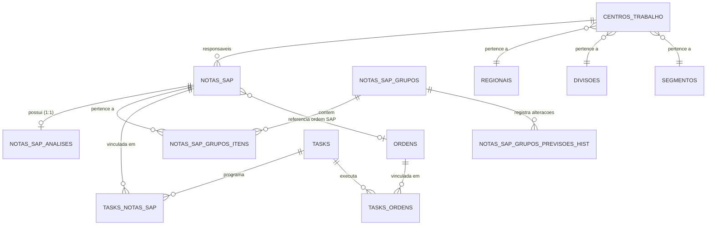

# Documento 1 — Diagnóstico Completo do Estado Atual da Gestão de Demandas e Notas SAP

## 1. Contexto e Escopo da Auditoria
Este relatório consolida a auditoria técnica e funcional realizada no repositório do **TaskFlow**, cobrindo o código-fonte Dart/Flutter, modelos de dados, serviços de integração, views SQL, triggers e estruturas de banco de dados PostgreSQL/Supabase.

O objetivo é mapear o ecossistema existente de Notas SAP, ordens, grupos de previsão, tarefas programadas e controle de prazos, identificando o que já está operacional, o que pode ser reutilizado, onde residem lacunas estruturais e quais inconsistências precisam ser equalizadas para sustentar a **Visão Gerencial da Carteira de Manutenção**.

---

## 2. Inventário de Funcionalidades Existentes

### 2.1 Gestão e Visualização de Notas SAP
* **Nome da Funcionalidade:** Gestão e Navegação de Notas SAP (Tabela, Cards, Calendário, Dashboard e Planejamento Macro).
* **O que efetivamente faz:** Permite consultar o catálogo completo de notas importadas do SAP, aplicar filtros multi-seleção por regional, centro de trabalho, prioridade, status e local, visualizar prazos calculados e disparar vínculos operacionais com tarefas e análises prévias.
* **Componente e Arquivo Responsável:** 
  * [notas_sap_view.dart](file:///Users/josepereiradasilvafilho/aplicativos/task/task2026/lib/widgets/notas_sap_view.dart)
  * [nota_sap_service.dart](file:///Users/josepereiradasilvafilho/aplicativos/task/task2026/lib/services/nota_sap_service.dart)
  * [nota_sap.dart](file:///Users/josepereiradasilvafilho/aplicativos/task/task2026/lib/models/nota_sap.dart)
* **Tabelas e Views Utilizadas:**
  * `public.notas_sap`: Tabela base contendo dados brutos importados do CSV/SAP.
  * `public.notas_sap_com_local`: View com resolução de local por ranking determinístico (Regional > Divisão > Segmento > Local).
  * `public.notas_sap_com_prazo`: View consumida primariamente pelo frontend que calcula `data_vencimento` e `dias_restantes`.
  * `public.tasks_notas_sap`: Relação N:M para identificação de tarefas vinculadas.
* **Regras de Negócio Existentes:**
  * **Pendência da Nota:** No modelo [nota_sap.dart](file:///Users/josepereiradasilvafilho/aplicativos/task/task2026/lib/models/nota_sap.dart#L88-L94), uma nota é considerada aberta (`estaAberta`) se `status_sistema` contiver `MSPN` ou `MSPR` e **não** contiver `CONC`, `ENCE` ou `CANC`.
  * **Paginação:** Suporta paginação de 50 registros por página (`_itensPorPagina = 50`) na visão em tabela.
  * **Enriquecimento:** As tarefas vinculadas são enriquecidas de forma assíncrona em lotes de 80 IDs (`batchSize = 80`) via `tasks_notas_sap`.
* **Limitações Identificadas:**
  * **Inconsistência de Status Concluída:** Em [notas_sap_dashboard_view.dart](file:///Users/josepereiradasilvafilho/aplicativos/task/task2026/lib/widgets/notas_sap_dashboard_view.dart#L165), o cálculo estatístico classifica como concluída qualquer nota contendo `MSEN`, enquanto o modelo [nota_sap.dart](file:///Users/josepereiradasilvafilho/aplicativos/task/task2026/lib/models/nota_sap.dart#L88) exige a presença de `MSPN`/`MSPR` e ausência de `CONC`/`ENCE`/`CANC`.
  * A tabela `notas_sap` não possui campo direto de previsão mensal (a previsão decorre exclusivamente do grupo).
* **Possibilidade de Reutilização:** **Total.** É a tela principal de trabalho e deve permanecer como o ponto focal operacional e analítico.

---

### 2.2 Agrupamento de Notas SAP e Previsão Macro
* **Nome da Funcionalidade:** Grupos de Notas SAP e Previsão Macro de Atendimento.
* **O que efetivamente faz:** Permite criar agrupamentos de notas técnicas afins (por equipamento, subestação ou campanha) para planejamento conjunto, associando uma previsão macro (mês/ano) e registrando histórico de mudanças.
* **Componente e Arquivo Responsável:** 
  * [nota_sap_grupo_service.dart](file:///Users/josepereiradasilvafilho/aplicativos/task/task2026/lib/services/nota_sap_grupo_service.dart)
  * [nota_sap_grupo.dart](file:///Users/josepereiradasilvafilho/aplicativos/task/task2026/lib/models/nota_sap_grupo.dart)
  * [02_grupos_previsao.sql](file:///Users/josepereiradasilvafilho/aplicativos/task/task2026/release_20261101_producao/sql/02_grupos_previsao.sql)
* **Tabelas e Views Utilizadas:**
  * `public.notas_sap_grupos`: Grupo com campos `mes_programacao_previsto`, `ano_programacao_previsto`, `status_grupo` (`ativo`, `encerrado`, `cancelado`).
  * `public.notas_sap_grupos_itens`: Tabela de junção `grupo_id` x `nota_sap_id` com rastreabilidade de quem adicionou.
  * `public.notas_sap_grupos_previsoes_hist`: Tabela de histórico de alterações de previsão.
* **Regras de Negócio Existentes:**
  * **Grupo Ativo Único:** Uma nota só pode pertencer a **um grupo ativo por vez** (enforced por trigger PostgreSQL `trigger_check_nota_em_grupo_ativo` e validado no serviço Dart).
  * **Paridade Mês/Ano:** Mês e ano devem ser ambos nulos ou ambos preenchidos (`chk_notas_grupos_paridade_mes_ano`).
  * **Histórico Automático:** Trigger de banco `trigger_historico_previsao_grupo` grava na tabela de histórico sempre que a previsão muda.
  * **Status de Programação Derivado:** O grupo não possui coluna estática de "programado"; seu status (`naoProgramado`, `parcial`, `total`) é derivado em tempo de execução consultando `tasks_notas_sap`.
* **Limitações Identificadas:**
  * **Previsão Exclusiva de Grupo:** Notas fora de grupo não possuem como receber previsão macro individual.
  * **Falta de Validação Previsão x Prazo:** O grupo registra mês/ano, mas o sistema não confronta essa previsão com as datas limites de vencimento das notas individuais contidas no grupo.
* **Possibilidade de Reutilização:** **Total.** Modelo altamente maduro, idempotente e com integridade referencial sólida.

---

### 2.3 Painel de Planejamento Macro de Backlog
* **Nome da Funcionalidade:** Planejamento Macro Mensal de Grupos de Notas.
* **O que efetivamente faz:** Apresenta uma linha do tempo mensal com carrossel de meses, totalizadores de grupos ativos, grupos com e sem previsão, grupos com previsão ultrapassada e contagem de notas programadas vs pendentes.
* **Componente e Arquivo Responsável:** 
  * [planejamento_macro_view.dart](file:///Users/josepereiradasilvafilho/aplicativos/task/task2026/lib/widgets/planejamento_macro/planejamento_macro_view.dart)
  * [nota_sap_backlog_service.dart](file:///Users/josepereiradasilvafilho/aplicativos/task/task2026/lib/services/nota_sap_backlog_service.dart)
  * [backlog_macro_models.dart](file:///Users/josepereiradasilvafilho/aplicativos/task/task2026/lib/models/backlog_macro_models.dart)
* **Tabelas e Views Utilizadas:**
  * `notas_sap_grupos`, `notas_sap_grupos_itens`, `notas_sap`, `tasks_notas_sap`, `tasks`, `notas_sap_analises`.
* **Regras de Negócio Existentes:**
  * **Status de Tarefa Válido para Programação:** Constante `kStatusTaskQueContamComoProgramada = {'PROG', 'ANDA', 'CONC', 'RPAR', 'RPGR'}`. Tarefas canceladas (`CANC`) são explicitamente desconsideradas.
  * **Previsão Ultrapassada:** Considera ultrapassado se `ano * 12 + mes < anoAtual * 12 + mesAtual` e ainda houver notas pendentes de programação.
  * **Carregamento O(N) e Chunking:** Consulta em 2 fases com particionamento em lotes de 200 IDs e cache de 3 minutos em memória.
* **Limitações Críticas Identificadas:**
  * **Invisibilidade de Notas sem Grupo:** O serviço [nota_sap_backlog_service.dart](file:///Users/josepereiradasilvafilho/aplicativos/task/task2026/lib/services/nota_sap_backlog_service.dart#L68-L86) inicia sua busca exclusivamente na tabela `notas_sap_grupos`. Consequentemente, **todas as notas que não estão associadas a nenhum grupo ativo são ignoradas**. O painel não reflete o universo real da carteira pendente da empresa.
  * **Não calcula a Cobertura Global da Carteira:** Não calcula o percentual de notas pendentes cobertas por previsão em relação ao total de notas pendentes importadas.
* **Possibilidade de Reutilização:** **Alta.** A arquitetura de serviço em 2 fases e os componentes visuais são excelentes, precisando apenas ser expandidos para incorporar as demandas fora de grupos.

---

### 2.4 Motor de Prazos e Vencimentos de Notas
* **Nome da Funcionalidade:** Cálculo de Prazos Legais/Regulatórios de Notas SAP.
* **O que efetivamente faz:** Calcula a `data_vencimento` e os `dias_restantes` com base na prioridade da nota e no centro de trabalho/segmento, correlacionando com parâmetros cadastrados.
* **Componente e Arquivo Responsável:** 
  * [criar_view_notas_sap_com_prazo.sql](file:///Users/josepereiradasilvafilho/aplicativos/task/task2026/criar_view_notas_sap_com_prazo.sql)
  * [regra_prazo_nota_service.dart](file:///Users/josepereiradasilvafilho/aplicativos/task/task2026/lib/services/regra_prazo_nota_service.dart)
  * [regra_prazo_nota.dart](file:///Users/josepereiradasilvafilho/aplicativos/task/task2026/lib/models/regra_prazo_nota.dart)
* **Tabelas e Views Utilizadas:**
  * `public.regras_prazo_notas`
  * `public.regras_prazo_notas_segmentos`
  * `public.centros_trabalho`
  * `public.segmentos`
  * `public.notas_sap_com_prazo` (View)
* **Regras de Negócio Existentes:**
  * Regra por prioridade normalizada (sem acentos).
  * Data de referência: `criacao` (soma dias a `criado_em`) ou `inicio_desejado` (soma dias a `inicio_avaria`).
  * Prioriza regras com segmento específico do centro de trabalho da nota sobre regras gerais (sem segmento).
  * `dias_restantes = (data_vencimento - CURRENT_DATE)::integer`.
* **Limitações Identificadas:**
  * Quando não há regra cadastrada ou a nota não possui prioridade, `data_vencimento` retorna `NULL`. Não havia uma tipificação explícita de "Sem Prazo Conhecido" para gestão de inconformidade cadastral.
* **Possibilidade de Reutilização:** **Total.** A view `notas_sap_com_prazo` é performática e centraliza a inteligência de cálculo no banco.

---

### 2.5 Análise Técnica Prévia e Estimativa de Horas
* **Nome da Funcionalidade:** Workspace de Análise Técnica de Notas SAP.
* **O que efetivamente faz:** Permite aos técnicos e analistas emitir diagnóstico prévio, detalhar escopo, levantar materiais necessários e registrar **estimativa de horas** e **quantidade de técnicos**.
* **Componente e Arquivo Responsável:** 
  * [01_pre_requisitos_e_analise_base.sql](file:///Users/josepereiradasilvafilho/aplicativos/task/task2026/release_20261101_producao/sql/01_pre_requisitos_e_analise_base.sql)
  * [nota_analise_workspace.dart](file:///Users/josepereiradasilvafilho/aplicativos/task/task2026/lib/widgets/nota_analise_workspace.dart)
  * [nota_sap_analise.dart](file:///Users/josepereiradasilvafilho/aplicativos/task/task2026/lib/models/nota_sap_analise.dart)
* **Tabelas e Views Utilizadas:**
  * `public.notas_sap_analises` (1:1 com `notas_sap`)
  * `public.notas_sap_analise_materiais` (1:N)
  * `public.notas_sap_comentarios` (1:N)
* **Regras de Negócio Existentes:**
  * A análise técnica é **100% não bloqueante**: uma nota pode ser programada em tarefa mesmo com status `nao_iniciada` ou sem análise.
  * Status possíveis: `nao_iniciada`, `em_analise`, `concluida`, `aguardando_informacao`, `cancelada`.
  * Campo `estimativa_horas NUMERIC(6,2)`.
* **Limitações Identificadas:**
  * A estimativa de horas só existe quando a análise prévia foi preenchida. Se a nota não foi analisada, `estimativa_horas` é `null`. O sistema não deve converter `null` em 0 horas na agregação da capacidade sem sinalizar a perda de cobertura da estimativa.
* **Possibilidade de Reutilização:** **Total.**

---

### 2.6 Programação Efetiva e Vinculação Operacional
* **Nome da Funcionalidade:** Vinculação Operacional entre Tarefas do TaskFlow e Notas/Ordens SAP.
* **O que efetivamente faz:** Liga uma ou mais Notas SAP e Ordens SAP a uma `Task` com cronograma executivo (datas de início/fim, equipes, executores e frota).
* **Componente e Arquivo Responsável:** 
  * [tasks_notas_sap](file:///Users/josepereiradasilvafilho/aplicativos/task/task2026/criar_tabela_notas_sap.sql#L43-L49)
  * [task_service.dart](file:///Users/josepereiradasilvafilho/aplicativos/task/task2026/lib/services/task_service.dart)
  * [task_form_dialog.dart](file:///Users/josepereiradasilvafilho/aplicativos/task/task2026/lib/widgets/task_form_dialog.dart)
* **Tabelas e Views Utilizadas:**
  * `public.tasks`
  * `public.tasks_notas_sap` (chave única `(task_id, nota_sap_id)`)
  * `public.tasks_ordens` (chave única `(task_id, ordem_id)`)
* **Regras de Negócio Existentes:**
  * Uma mesma tarefa pode contemplar múltiplas notas (ex: intervenção conjunta em um bay ou transformador).
  * Uma nota pode ter histórico de múltiplas tarefas ao longo do tempo (ex: tentativa anterior cancelada e nova tarefa programada).
* **Possibilidade de Reutilização:** **Total.**

---

## 3. Matriz de Entidades e Relacionamentos do Sistema

---

## 4. Diagnóstico das Lacunas Técnicas e Funcionais

| ID | Área | Situação Atual | Lacuna Identificada | Impacto Gerencial |
| :--- | :--- | :--- | :--- | :--- |
| **LAC-01** | **Escopo da Carteira** | O `NotaSapBacklogService` só busca notas vinculadas a grupos ativos. | Notas pendentes não agrupadas ficam completamente invisíveis no planejamento mensal. | A gestão não enxerga a totalidade do passivo de manutenção. |
| **LAC-02** | **Previsão Individual** | Previsão de mês/ano existe apenas na tabela `notas_sap_grupos`. | Uma nota isolada não pode receber uma previsão gerencial sem ser forçada a entrar em um grupo fictício. | Dificulta a previsão rápida de demandas avulsas que não justificam formação de grupo. |
| **LAC-03** | **Previsão vs. Prazo** | O sistema compara apenas mês previsto com o mês atual (previsão ultrapassada). | Não compara o mês da previsão com o prazo limite (`data_vencimento`) da demanda. | Risco oculto: uma nota que vence em março pode estar prevista para outubro sem nenhum alerta de violação de prazo. |
| **LAC-04** | **Incerteza Mês vs. Dia** | Não há regra formal para tratar o intervalo do mês em relação a um dia de vencimento. | Não há distinção entre previsão anterior ao prazo, previsão no mesmo mês (atenção) e posterior (descumprimento). | Decisões gerenciais baseadas em falsa segurança de cumprimento. |
| **LAC-05** | **Indicador de Cobertura** | O KPI atual calcula apenas `% de notas programadas dentro dos grupos`. | Ausência do KPI de Cobertura da Carteira: `(Notas com Previsão / Total Pendentes) * 100`. | Impossibilidade de medir a meta estratégica de 100% de previsibilidade. |
| **LAC-06** | **Capacidade Operacional** | Há dados de equipes, executores e horas no sistema, e estimativa de horas nas análises. | Não há confrontação entre a demanda estimada prevista para o mês e a capacidade utilizável das equipes. | Planos de atendimento formulados sem validação de viabilidade executiva. |
| **LAC-07** | **Status Divergente** | `NotaSAP.estaAberta` usa `!CONC && !ENCE && !CANC`, enquanto o Dashboard usa `!MSEN`. | Risco de divergência numérica entre a contagem de notas abertas na tabela e no dashboard. | Falta de consistência nos relatórios executivos. |
